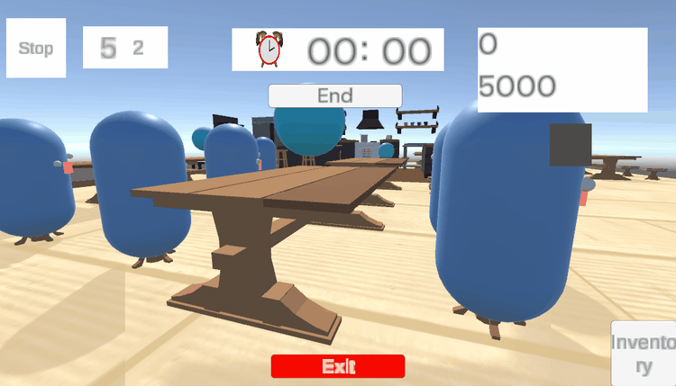
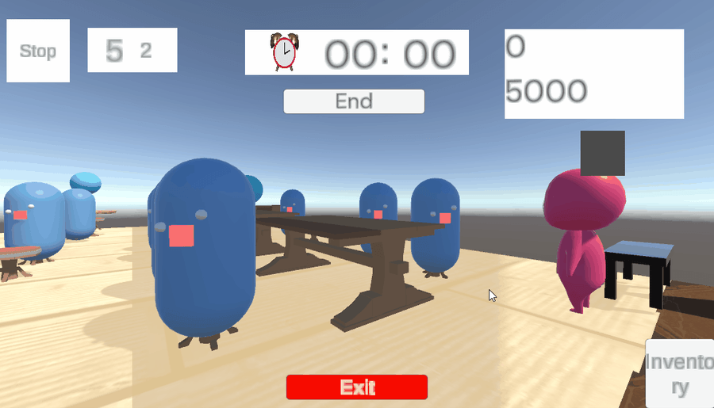

# 🍽️ 평생 영업해주세요 : 3D 식당 운영 시뮬레이션 게임

  
  

> 손님의 주문을 받고 서빙하는 메인 타이쿤 루프에, 언제 터질지 모르는 '기현상'이라는 돌발 변수를 통제해야 하는 3D 식당 경영 시뮬레이션 게임입니다.  
> 5인 팀에서 클라이언트 개발을 담당하며, **파이프라인의 데이터 캡슐화**, **FIFO 큐 기반의 순서 동기화**, 그리고 **돌발 기현상의 안정적인 상태 제어**에 집중했습니다.

 

## 기술 스택
* **엔진:** Unity 2022.3.62f3
* **언어:** C#
* **버전 관리:** Git, GitHub, Sourcetree

 

## 주요 구현 기능 및 기여

### 1. 주문·조리·서빙 파이프라인 구축
* **데이터 연속성 보장:** 음식과 목적 테이블 정보를 결합한 `OrderData` 래퍼 클래스를 설계해 주문 접수부터 조리, 테이블 서빙까지 데이터 유실 없는 파이프라인 구축
* **FIFO 순서 보장:** 트레이 슬롯의 물리적 위치와 상관없이, `Queue<int>`를 활용해 음식이 트레이에 올라온 순서대로 NPC가 수령하도록 보장
* **비동기 흐름 제어:** 코루틴(Coroutine)과 NavMeshAgent를 연동하여 NPC의 이동, 수령 대기, 좌석별 음식 배치를 직렬화하여 제어

### 2. 기존 서빙 루프를 활용한 기현상 시스템 연동
* **기존 흐름 유지:** 서빙 시스템과의 코드 중복 및 충돌을 방지하기 위해 기존의 정상 `OrderData`와 이동 루프를 그대로 활용하고, NPC가 트레이에서 음식을 집는 시점에 음식 오브젝트만 잘못된 음식 프리팹으로 교체
* **상태 제어:** `Pending`(대기)과 `Active`(활성) 상태를 분리하여, 기현상 처리 과정에서 발생 요청이 중복 실행되는 것을 방지
 

## 문제 해결 과정

* **트레이 물리 슬롯과 NPC 수령 순서 불일치 해결**
  * **문제 상황:** 음식이 빠져나간 빈 슬롯에 다음 음식이 채워질 때, 단순 슬롯 번호 순회 방식으로 인해 먼저 조리되어 대기 중이던 음식보다 나중에 들어온 음식을 먼저 수령하는 역순 문제 발생
  * **해결 과정:** 물리적 배치 위치와 논리적 처리 순서를 분리하기 위해, 음식이 놓인 슬롯 번호를 `Queue<int>`에 순서대로 등록하고 NPC가 먼저 들어온 슬롯부터 꺼내(FIFO) 음식을 수령하도록 개선

* **테이블 ID(1-based)와 내부 배열 인덱스(0-based) 불일치 해결**
  * **문제 상황:** `Table` 객체의 식별 번호(1-based)와 내부 배열 인덱스(0-based) 기준이 모듈마다 혼재되어, 서빙 루프에서 엉뚱한 테이블의 주문을 조회하여 잘못된 서빙을 하거나 무한 루프에 빠져 Unity Editor가 프리징되는 문제 발생
  * **해결 과정:** 주문 데이터(`OrderData`) 생성 시점에 0-based 인덱스로 일원화하도록 데이터 변환 계약을 표준화하여 파이프라인 전반의 일관성 확보

 

## 링크
* [상세 포트폴리오 (Notion)](https://app.notion.com/p/ab55968681bd82cbb19f01e2da2ba894?source=copy_link)
